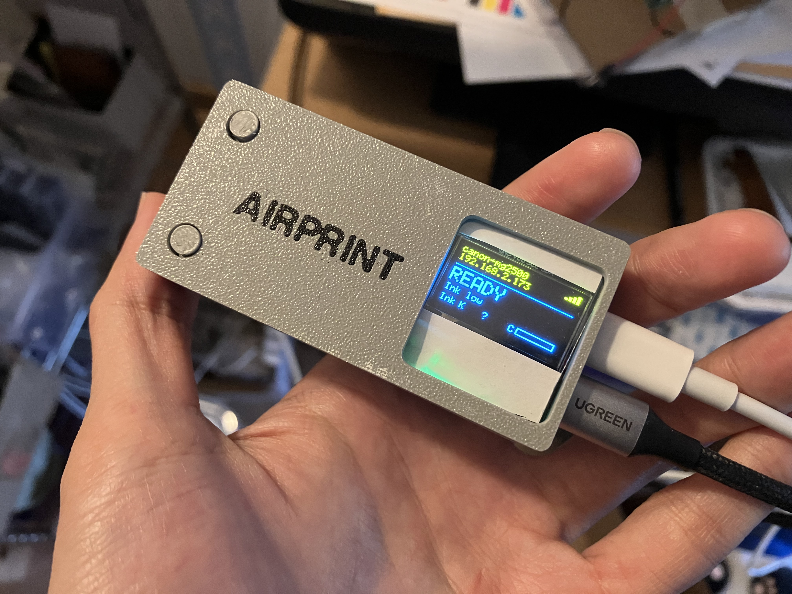
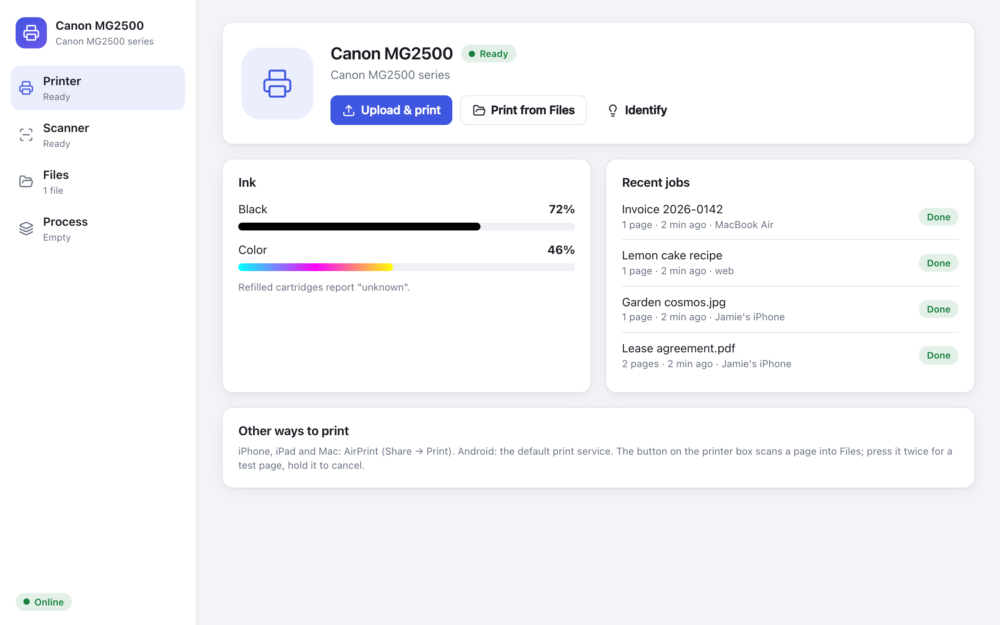
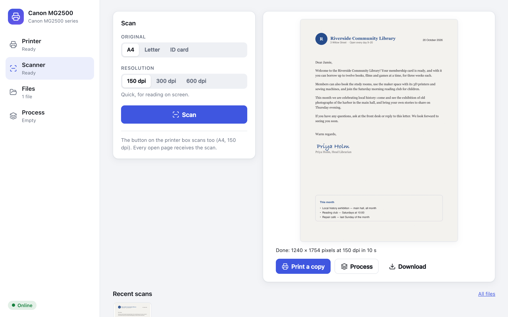
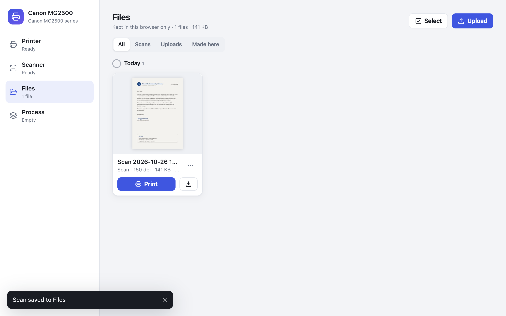
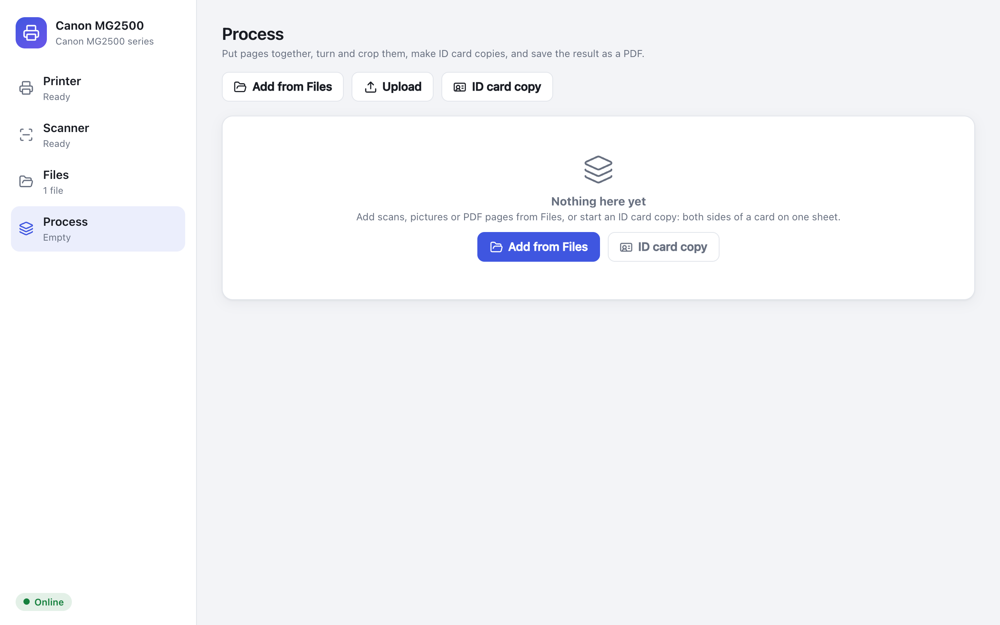
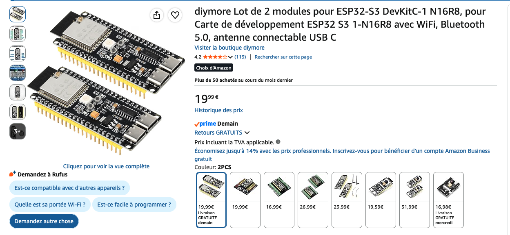
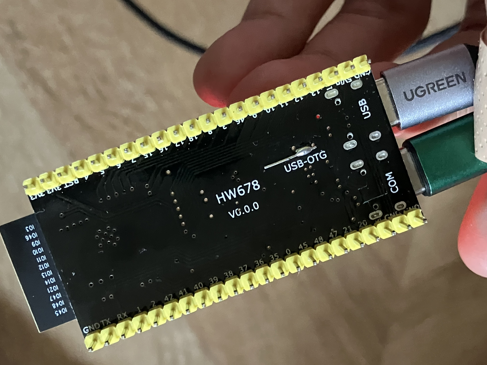
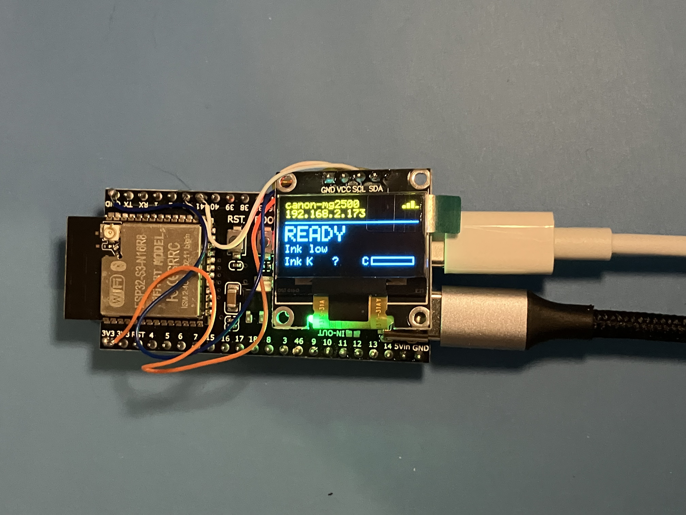

# Add AirPrint support to your old printer, using just a cheap ESP32-S3

Turns any USB-only printers into a wireless printer and scanner. An ESP32-S3 board plugs into the printer's USB port and joins your WiFi:

- **Print** from iPhone, iPad and Mac (AirPrint), Android (Mopria) and Linux, with no drivers or apps.
- **Scan** from any browser, from Image Capture and Preview on a Mac, or with the button on the board.
- **A web app** on your phone or computer: print PDFs and pictures, scan, keep the files in the browser, and put pages together (rotate, crop, ID card copies) into a PDF.



| | |
|---|---|
|  |  |
|  |  |

## Supported printers

- Canon PIXMA MG2500S: My own printer, validated, fully supported
- Other printers? Please open an issue or a PR

## What you need

Just one thing: An ESP32-S3 dev board with two USB-C ports:



Optionally: a SSD1315 OLED screen and a 3D-printed case, see later in this tutorial

## Setup

**Step 1: Hardware.** Plug the ESP32-S3 into your computer via the COM port on the ESP32 board (NOT the port labelled "USB")



**Step 2: Settings.** Build once (`pio run`): this creates `.env`. Edit it:
   ```
   WIFI_SSID=your-network
   WIFI_PASSWORD=your-password
   PRINTER_NAME=Canon MG2500 (ESP32)
   HOSTNAME=canon-mg2500
   MODE=debug
   ```
   `MODE=debug` lets you update the board over WiFi later (see below); `MODE=normal` does without. `.env` is git-ignored, so your WiFi password stays local.

**Step 3: Flash.** Connect the board's **COM** port to your computer and run `pio run -t upload`. PlatformIO finds the board's serial port; if several are connected, add `--upload-port /dev/cu.usbmodem…`.

## Using it

Plug the printer to the port labelled "USB"

NOTE: You may also need to bridge the "USB-OTG" solder join on the board, so that it supplies 5V to the printer. While the printer doesn't actively use 5V, it sense the USB plug using this signal.

- **The web app:** open `http://canon-mg2500.local/` (your `HOSTNAME`) on your phone or computer.
- **The button on the board** (BOOT, or one on GPIO4): press to scan, press twice for a test page, hold 2 s to cancel.
- **Print from a phone or a Mac:** on an iPhone, Share → Print and pick the printer. On a Mac, add it in System Settings → Printers & Scanners.
- **Scan on a Mac:** open Image Capture (or Preview → File → Import from Scanner) and pick the printer.

## Adding OLED screen and buttons

This step is **optional**, you can connect a SSD1315 OLED screen with the pinout below:

| OLED | ESP32-S3 |
|---|---|
| VCC | 3V3 |
| GND | GND |
| SCL | GPIO41 |
| SDA | GPIO42 |

Connect it before powering on: the board only looks for it at startup.



For buttons, wire each one between a pin and GND:

| Button | ESP32-S3 | Action |
|---|---|---|
| 1 | GPIO4 | Same as BOOT (scan, test page, cancel) |
| 2 | GPIO5 | Not assigned: add your own in `on_user_button()` (`src/main.c`) |

While the screen is off, a press only wakes it up.

## Development

Set `MODE=dev` and flash: print jobs are processed but not printed, and scans show a built-in test page.

On the computer, without the board: `make -C host && cd host && ./airprint_host`, then open http://localhost:8631/ (an emulated printer and scanner). To work on the web app with live reloading: `cd web && npm run dev` (it talks to that server; `DEVICE=http://<board IP> npm run dev` talks to the board).

Technical details are in [AGENTS.md](AGENTS.md).

## Adding a printer

Each printer model is a driver in `components/printers/`: copy `canon_mg2500.c` and select yours with `CONFIG_PRINTER_DRIVER`. See [AGENTS.md](AGENTS.md) for details.
