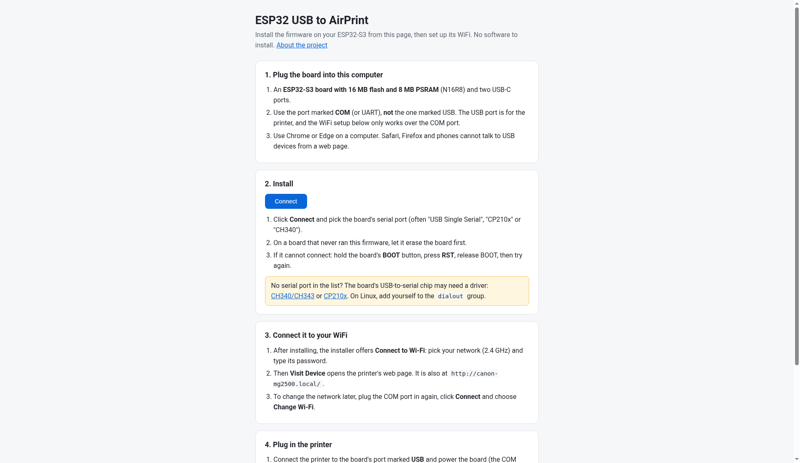
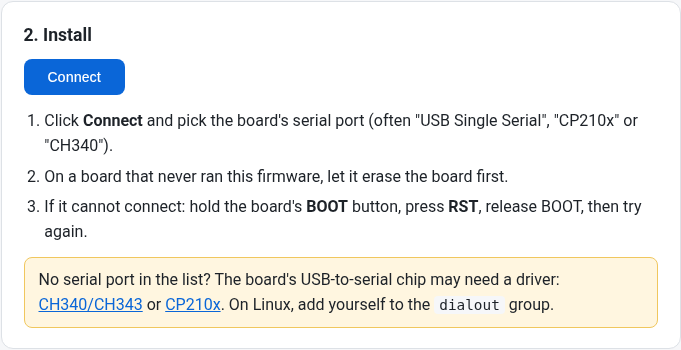
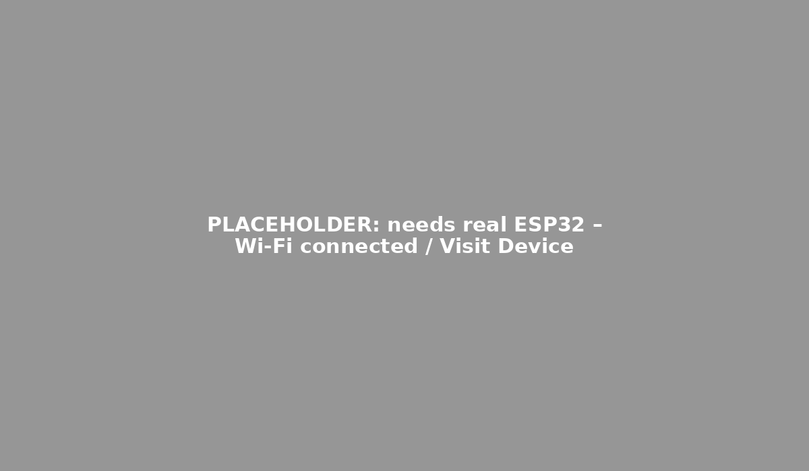

# Installing from the browser (web installer)

The web installer puts the ESP32 USB to AirPrint firmware on your board from a web page and sets up its WiFi in the same window. You don't need PlatformIO or a `.env` file. It runs on [ESP Web Tools](https://github.com/esphome/esp-web-tools) (Web Serial) and sets up WiFi with [Improv Wi-Fi](https://www.improv-wifi.com/serial/).

Installer page: <https://ngxson.github.io/esp32-usb-to-airprint/> (the README links here; the page is published by GitHub Pages from `master`).

## 1. What you need

- **An ESP32-S3 board with 16 MB flash and 8 MB PSRAM (N16R8)** and two USB-C ports.
- **Chrome or Edge on a desktop or laptop.** Safari, Firefox and phones can't talk to USB devices from a web page.
- **A USB data cable.** Some cables only charge. If no port appears, try another cable.
- A **2.4 GHz** WiFi network and its password.

## 2. Plug the board in

Connect the board's port marked **COM** (or UART) to your computer. **Don't use** the port marked **USB**: that one is for the printer, and WiFi setup only works over COM.

## 3. Open the installer and pick a version

Open the installer page in Chrome or Edge.



If the page offers more than one version, pick one:

- **Standard**: printing and scanning.
- **Debug (updates over WiFi)**: you can also update the firmware and read its log over WiFi (`tools/remote.py`). Anyone on your network can do the same, so use it only on a network you trust.

The version number appears next to the button.

## 4. Connect and choose the serial port

Click **Connect**.



The browser lists serial ports. Pick the board. It's often called "USB Single Serial", "CP210x" or "CH340". Then click **Connect**.


## 5. Install

Choose to install. On a board that has never run this firmware, let the installer erase the board first.


Keep the cable plugged in while it flashes.


The installer writes the bootloader, partition table, OTA data and app as separate parts rather than one merged image. That means **updating later keeps your saved WiFi network**. If your board runs an older build, the installer offers **Update**.

## 6. Set up WiFi (Improv)

After the install, choose **Connect to Wi-Fi**. The installer lists the networks the board can see. Pick yours (2.4 GHz) and type the password.


The board tries the network first and saves it only if it connects. If the password is wrong, the board keeps its previous network. The saved network takes priority over any WiFi set in `.env`.

When it connects, click **Visit Device** to open the printer's web page at `http://<board IP>/`.



**To change the network later:** plug in the COM port again, click **Connect** and choose **Change Wi-Fi**.


You can also set WiFi from a terminal: `tools/improv.py <serial port> wifi <network>` (it also supports `info` and `scan`).

## 7. Next: plug in the printer and print

1. Connect the printer to the board's port marked **USB**. Power the board; a phone charger on the COM port is fine.
2. Bridge the board's **USB-OTG** solder pads so the board supplies 5 V to the printer. Most printers only show up when they detect it.
3. Open the board's web page. With the default host name it's at `http://canon-mg2500.local/`.
4. Print:
   - **iPhone/iPad:** Share → Print, then pick the printer (AirPrint).
   - **Mac:** System Settings → Printers & Scanners → add the printer.
   - **Android:** use Mopria.
   - **Any device:** use the board's web page.
5. Scan from the web page, from Image Capture or Preview → File → Import from Scanner on a Mac, or with the board's button (press to scan).

Supported printers are listed in the [README](../README.md#supported-printers).

## Troubleshooting

| Problem | What to try |
|---|---|
| "This browser cannot install the firmware" | Use Chrome or Edge on a computer, not a phone, Safari or Firefox. |
| "The installer needs a secure page" | Open the page over https, or from `localhost` if you're testing locally. |
| No serial port in the list | Use a data cable and the **COM** port. Install the USB-serial driver: [CH340/CH343](https://www.wch-ic.com/downloads/CH343SER_EXE.html) or [CP210x](https://www.silabs.com/developer-tools/usb-to-uart-bridge-vcp-drivers). On Linux, add yourself to the `dialout` group, then log out and back in. |
| Can't connect or flashing fails | Put the board in download mode: hold **BOOT**, press **RST**, release **BOOT**, then click **Connect** again. Close any other program using the port, such as a serial monitor or `pio`. |
| Connect to Wi-Fi doesn't appear or times out | Make sure you're on the **COM** port, since Improv only answers on that UART. Press **RST**, then connect again; on a board that already has the firmware, **Connect** goes straight to the WiFi options. Or use `tools/improv.py <port> info`. |
| WiFi won't join | Use a 2.4 GHz network and check the password. The board keeps the previous network if the new one fails. |
| `canon-mg2500.local` doesn't open | Use the IP from **Visit Device**. Your build may use a different `HOSTNAME`. |

## Testing locally (developers)

```sh
cd flasher && npm ci && cd ..
pio run -e esp32s3                     # MODE in .env: normal / debug
python3 tools/gen_flasher.py site normal --label Standard
python3 -m http.server -d site         # open http://localhost:8000/
```
